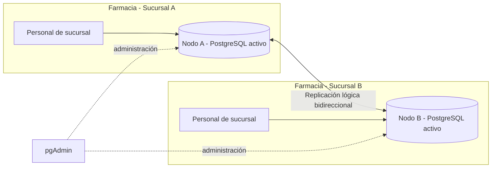

# Diseño inicial de arquitectura

## Caso de uso

Cadena de farmacias con dos sucursales. Cada sucursal registra ventas y movimientos de inventario en su nodo local; el catálogo y las operaciones se replican al otro nodo.

## Topología propuesta

## Sincronización y límites

Se plantea replicación lógica nativa de PostgreSQL mediante una publicación y una suscripción en cada dirección. La opción de suscripción `origin = 'none'` evita volver a enviar los cambios que ya llegaron por replicación y ayuda a prevenir ciclos.

La replicación lógica no hace que las dos instancias funcionen como un clúster con consenso ni garantiza escritura segura simultánea de la misma fila. Un conflicto por clave única u otra restricción puede detener la aplicación de cambios y requerir resolución manual. La demostración debe documentar esa limitación.

## Regla de negocio para reducir conflictos

- Cada sucursal actualiza únicamente las filas de inventario asociadas a su propio `sucursal_id`.
- Cada venta recibe un identificador UUID para evitar colisiones entre nodos.
- El catálogo de medicamentos se trata como información administrada centralmente durante la demostración; no se editará a la vez desde ambos nodos.
- No se harán cambios concurrentes a una misma fila durante la prueba normal. Un caso de conflicto se provocará de forma controlada únicamente en la sección de evaluación.

## Seguridad del entorno didáctico

- Los puertos de los contenedores se exponen solo a `localhost`.
- Se usarán credenciales locales de desarrollo distintas de las cuentas reales del equipo.
- No se guardarán contraseñas personales ni datos reales de pacientes o clientes.
- pgAdmin sirve para conectarse y administrar; la replicación la realizan los servidores PostgreSQL.

## Pendiente de concretar antes de la implementación

- Fijar la versión exacta de la imagen de PostgreSQL para ambos contenedores.
- Preparar el esquema, las publicaciones, las suscripciones y el procedimiento idempotente de arranque.
- Verificar compatibilidad de la topología bidireccional con la versión elegida y documentar cómo se observa y recupera una detención por conflicto.
- Ejecutar las pruebas del proyecto cuando Docker Desktop esté activo.
