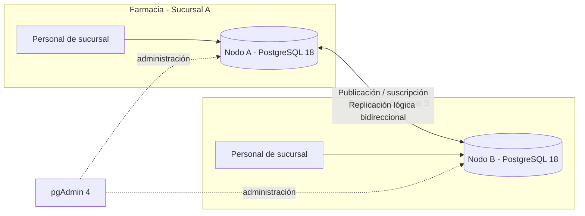

# Trabajo de Fin de Semestre: Replicación de Base de Datos

## Sistema de replicación para una cadena de farmacias

**Curso:** Infraestructura de Tecnología de Información  
**Escuela Profesional:** Ingeniería de Sistemas  
**Integrantes:** Pendiente  
**Docente:** Pendiente  
**Fecha:** Pendiente

> Borrador de trabajo. Los resultados de pruebas se completarán con evidencia después de ejecutar la solución. No se deben presentar resultados pendientes como si ya hubieran sido medidos.

## Resumen

Este proyecto propone y desarrolla una demostración académica de replicación bidireccional lógica entre dos instancias PostgreSQL. El caso de uso es una cadena de farmacias con dos sucursales que registran ventas y movimientos de inventario de forma local. Cada instancia publica sus cambios y recibe los cambios de la otra. Dos clústeres locales independientes, iniciados mediante scripts PowerShell, permiten ejecutar los nodos en una computadora; pgAdmin permite administrarlos y observar los datos.

La solución prioriza una instalación reproducible y comprensible para un proyecto universitario. Para reducir conflictos, las ventas usan UUID y cada sucursal modifica el inventario que le pertenece. La replicación es asíncrona: el cambio se confirma primero en el nodo local y luego llega al otro. PostgreSQL puede detener la aplicación de una transacción ante ciertos conflictos; el diseño incluye una regla de prevención y un procedimiento manual de diagnóstico y recuperación.

## 1. Descripción del problema

Una cadena con más de una farmacia necesita consultar ventas e inventario de cada sede. Si toda la operación depende de una única base central, una interrupción de red puede impedir que una sede registre sus transacciones. Una copia local por sede permite continuar el registro local y sincronizar los cambios cuando se recupere la conexión.

El problema técnico consiste en mantener dos bases con estructuras compatibles y propagar las inserciones, actualizaciones y eliminaciones entre ellas, conservando la integridad de ventas, detalle de venta, medicamentos y existencias. También se debe explicar qué sucede cuando ambos nodos modifican datos incompatibles.

## 2. Objetivos

### Objetivo general

Diseñar e implementar una demostración de replicación bidireccional entre dos nodos PostgreSQL para ilustrar disponibilidad, sincronización de datos y manejo de conflictos en un caso de farmacia.

### Objetivos específicos

- Justificar la elección de PostgreSQL con criterios de replicación, rendimiento, escalabilidad y facilidad de uso.
- Diseñar una arquitectura activa-activa de dos nodos con publicación y suscripción en ambas direcciones.
- Crear el esquema de sucursales, medicamentos, inventario, ventas y detalle de ventas.
- Configurar y administrar los nodos locales con PowerShell y pgAdmin.
- Comprobar replicación en ambos sentidos, interrupción temporal y manejo de un conflicto controlado.

## 3. Selección de tecnología

Se selecciona **PostgreSQL** como gestor de base de datos y **pgAdmin 4** como herramienta de administración. La elección cumple el requisito del enunciado, que permite PostgreSQL y excluye MySQL/MariaDB.

| Criterio | Justificación para este proyecto |
|---|---|
| Replicación | PostgreSQL incluye replicación lógica mediante publicaciones y suscripciones. Un nodo puede publicar tablas y también suscribirse a las publicaciones de otro nodo. Desde PostgreSQL 16, la opción `origin = 'none'` permite solicitar únicamente cambios sin origen de replicación, lo que ayuda a prevenir ciclos entre nodos. |
| Rendimiento | La replicación lógica transmite cambios confirmados a nivel de filas, no copias completas de cada archivo de datos. Esto permite replicar las tablas necesarias y observar el comportamiento con ventas e inventario. El rendimiento real de esta demo se medirá; no se atribuyen cifras sin una prueba reproducible. |
| Escalabilidad | Se pueden añadir suscriptores y extender la topología. Sin embargo, la solución de dos nodos no es un clúster de consenso y el costo de coordinación/conflictos aumenta cuando varias sedes modifican las mismas filas. |
| Facilidad de uso | pgAdmin proporciona una interfaz gráfica para consultar tablas, ejecutar SQL y revisar conexiones. Los scripts PowerShell inicializan dos clústeres con puertos y carpetas de datos separados. |
| Costo y disponibilidad | PostgreSQL es software de código abierto con documentación oficial pública; PostgreSQL 18 y pgAdmin están disponibles en el equipo usado para la demostración. |

Se utiliza PostgreSQL 18.6 en ambos nodos porque es la versión instalada en el equipo y permite mantener una única versión mayor para esta demostración. Cada nodo tiene un directorio de datos independiente bajo `%LOCALAPPDATA%\FarmaciaReplicacion`, y escucha en `127.0.0.1` en los puertos 5433 y 5434. La instancia previa de PostgreSQL en 5432 y la base `BOLETA_VENTAS` se mantienen separadas.

### Alcance de la elección

El proyecto implementa replicación lógica nativa en dos direcciones y demuestra reglas de operación que reducen conflictos. No busca reemplazar plataformas de replicación distribuida con resolución automática avanzada, ni afirma que la replicación lógica nativa sea una solución de alta disponibilidad empresarial sin intervención.

## 4. Diseño de la arquitectura

### 4.1 Topología

Cada sucursal se conecta a su propio nodo PostgreSQL. Ambos nodos publican los cambios de las tablas del sistema y se suscriben a la publicación del otro. pgAdmin se conecta como cliente de administración a cada puerto.

### 4.2 Componentes

- **Nodo A:** clúster PostgreSQL local, puerto `5433`, datos en `%LOCALAPPDATA%\FarmaciaReplicacion\nodo-a`.
- **Nodo B:** clúster PostgreSQL local, puerto `5434`, datos en `%LOCALAPPDATA%\FarmaciaReplicacion\nodo-b`.
- **Scripts PowerShell:** inicializan, configuran, inician y detienen cada clúster de forma independiente.
- **pgAdmin 4:** cliente visual para consultar ambos nodos; no realiza la replicación.
- **Usuario `replicador`:** rol dedicado con permiso de replicación y lectura de tablas publicadas.
- **Base `farmacia`:** catálogo y operaciones simuladas para dos sucursales.

Los puertos se enlazan a `127.0.0.1`, por lo que esta configuración está pensada para una demo en la computadora local, no para exponer los servidores en Internet.

### 4.3 Mecanismo de sincronización

Cada nodo crea una publicación de las tablas `sucursal`, `medicamento`, `inventario`, `venta` y `detalle_venta`. En cada nodo se define una suscripción a la publicación del nodo opuesto. Ambas instancias arrancan con el mismo esquema y datos base; la suscripción se crea con `copy_data = false` para no volver a insertar ese catálogo inicial y generar colisiones de claves.

La opción `origin = 'none'` evita reenviar como nuevos los cambios que el nodo recibió por replicación. La sincronización es asíncrona: una transacción aparece primero en su nodo de origen y llega después al otro.

### 4.4 Estrategia para reducir y resolver conflictos

La regla normal de escritura asigna a cada sucursal la propiedad de sus filas de inventario. Sucursal A actualiza filas con `sucursal_id = 1`; Sucursal B actualiza filas con `sucursal_id = 2`. Las ventas usan UUID para reducir la posibilidad de claves duplicadas. El catálogo se modifica de forma centralizada durante la demostración, evitando edición concurrente de la misma fila.

Estas reglas reducen conflictos de negocio, pero no imponen por sí solas permisos por sucursal. Un cambio simultáneo a una misma fila puede causar que la aplicación lógica reporte un conflicto y se detenga hasta corregir los datos. El procedimiento propuesto es revisar el log y las estadísticas, identificar la clave afectada, aplicar una decisión explícita y comprobar que la suscripción continúa. No se omiten transacciones a ciegas porque eso podría perder cambios relacionados.

### 4.5 Seguridad

- Las conexiones de los dos nodos se enlazan solo a `127.0.0.1`.
- La replicación usa un rol diferente del usuario administrador.
- Las contraseñas de ejecución se guardan en `.env`, archivo excluido de Git; se publica solo `.env.example` con valores de demostración.
- No se usan datos reales de pacientes, recetas ni clientes.
- Las credenciales de ejemplo solo sirven para el entorno educativo local y deben cambiarse antes de cualquier despliegue compartido.

## 5. Implementación

La implementación se organiza en scripts PowerShell de inicio, detención, verificación y medición, archivos SQL de esquema y demostración, y una configuración de suscripciones creada por el script de inicio. El servidor PostgreSQL preexistente en Windows permanece independiente. pgAdmin se conecta a `127.0.0.1:5433` y `127.0.0.1:5434`.

El esquema incluye sucursales, medicamentos, inventario por sucursal, ventas y líneas de venta. Las claves primarias y foráneas mantienen la relación entre las operaciones. Las consultas de ejemplo muestran una venta creada en cada nodo y el inventario correspondiente.

### Estado de ejecución

Los scripts y archivos de configuración están preparados. La prueba de integración y las mediciones siguen pendientes; no se afirma todavía que los nodos se hayan iniciado ni que los datos se hayan replicado.

## 6. Evaluación y pruebas

El plan completo está en `docs/plan_pruebas.md`. Incluye el estado inicial, replicación Nodo A→B, replicación Nodo B→A, integridad referencial, escrituras simultáneas en filas distintas, interrupción temporal y un conflicto controlado con su recuperación.

### Resultados

| Prueba | Resultado | Evidencia |
|---|---|---|
| Inicio de los dos clústeres locales | Pendiente | Requiere ejecutar `scripts/iniciar.ps1` en el equipo. |
| Inicio y suscripciones | Aprobada | Ambos clústeres PostgreSQL 18.6 iniciaron en 5433 y 5434; las dos suscripciones quedaron habilitadas. |
| Replicación en ambos sentidos | Aprobada | Se ejecutaron las demostraciones A→B y B→A; ambos nodos mostraron las dos ventas y sus detalles. |
| Consistencia e integridad | Aprobada | La consulta de registros huérfanos devolvió 0 en cada nodo. |
| Tolerancia a una interrupción temporal | Aprobada | Una venta local de A llegó a B después de detener y reiniciar el servidor B. |
| Conflicto y recuperación | Aprobada | Un código de medicamento duplicado detuvo la aplicación; al asignar códigos únicos, ambos nodos convergieron. |
| Rendimiento | Medición inicial | Para 100 ventas: inserción local 78.5 ms; convergencia observada 66.9 ms en una ejecución. Incluye la invocación del cliente y el sondeo, no representa latencia pura ni una prueba estadística. |
| Escrituras simultáneas en nodos distintos | Aprobada | Dos ventas con UUID diferentes se insertaron en paralelo y ambas convergieron en los dos nodos; el marcador reproducible está en `docs/plan_pruebas.md`. |

La medición se realizó el 24 de noviembre de 2026 en una computadora con Windows y PostgreSQL 18.6, usando dos nodos locales. Una sola ejecución no permite generalizar el resultado a otros equipos o redes. Los datos brutos están en `informe/resultados_rendimiento.csv`.

## 7. Limitaciones

- La replicación es asíncrona y puede tener retraso.
- La configuración no incluye consenso, balanceador, descubrimiento automático de nodo activo ni failover transparente.
- La topología tiene dos nodos locales dentro de un equipo; no reproduce la latencia ni las fallas de dos sedes físicas.
- Los conflictos que violan restricciones pueden detener el worker y necesitar intervención manual.
- El modelo de farmacias es didáctico, no administra recetas, datos clínicos ni información de clientes reales.

## 8. Conclusiones y recomendaciones

PostgreSQL permite construir una demostración entendible de replicación lógica bidireccional con dos nodos, y pgAdmin facilita inspeccionar el resultado. Separar el inventario por sucursal y usar UUID en las ventas ayuda a que las escrituras normales de ambas sedes no compitan por las mismas claves.

La replicación no elimina la necesidad de reglas de negocio. Para un entorno real se recomendaría evaluar requisitos de consistencia, resolución de conflictos, operación de sedes y recuperación ante desastres con una solución distribuida soportada, controles de seguridad más estrictos, monitoreo y copias de seguridad verificadas.

## 9. Criterios de evaluación del enunciado

| Criterio | Puntaje indicado |
|---|---:|
| Comprensión y aplicación de conceptos de replicación | 2 |
| Diseño adecuado de la arquitectura | 2 |
| Implementación funcional y eficiente | 6 |
| Resultados de pruebas y análisis de rendimiento | 1 |
| Calidad de documentación y presentación oral | 2 |
| **Suma de la rúbrica** | **13** |

El objetivo del documento indica que el proyecto vale 12 puntos, mientras que los valores de la rúbrica suman 13. Se debe confirmar con el docente qué total aplicar; este informe conserva los valores tal como aparecen en la tabla de evaluación.

## Referencias

- PostgreSQL Global Development Group. *Logical Replication*. https://www.postgresql.org/docs/18/logical-replication.html
- PostgreSQL Global Development Group. *CREATE SUBSCRIPTION*, opción `origin`. https://www.postgresql.org/docs/18/sql-createsubscription.html
- PostgreSQL Global Development Group. *Conflicts*. https://www.postgresql.org/docs/18/logical-replication-conflicts.html
- PostgreSQL Global Development Group. *Versioning Policy*. https://www.postgresql.org/support/versioning/
- pgAdmin Development Team. *pgAdmin 4 Documentation*. https://www.pgadmin.org/docs/pgadmin4/latest/
- Enunciado del Trabajo de Fin de Semestre: Replicación de Base de Datos, curso de Infraestructura de Tecnología de Información.
